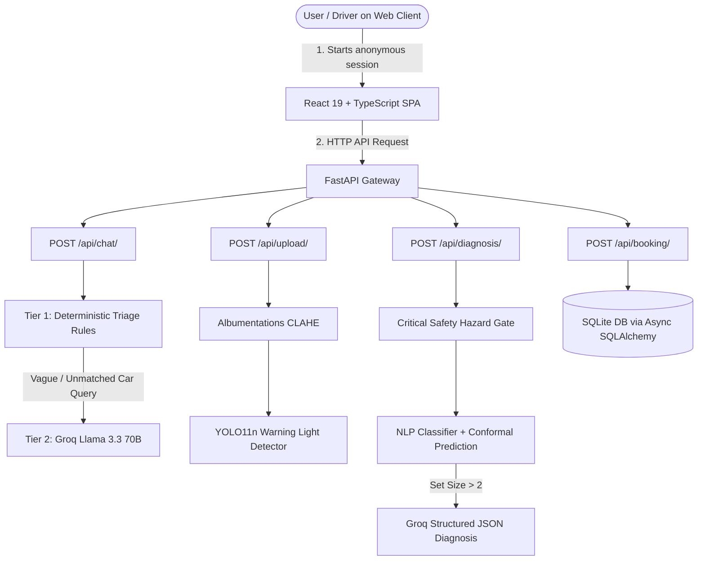
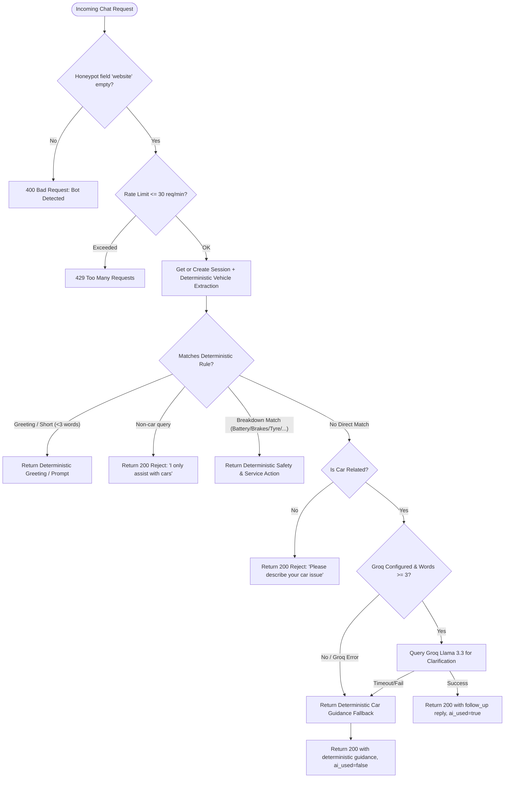
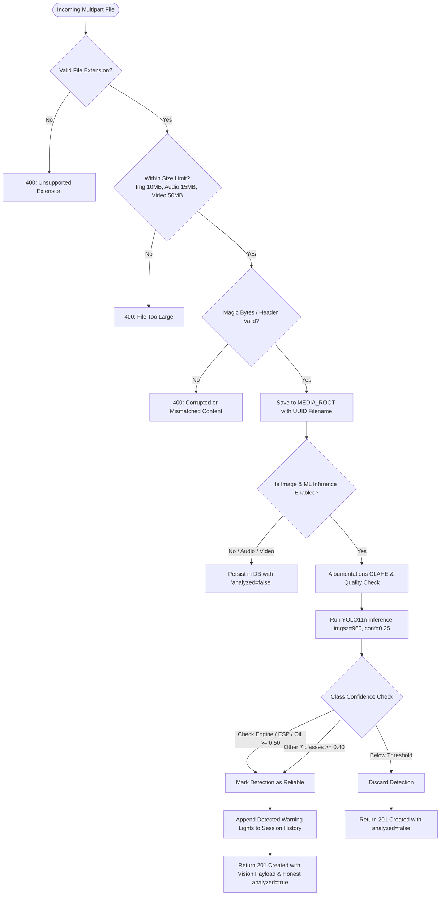
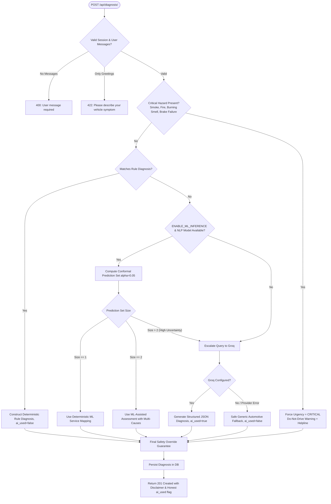
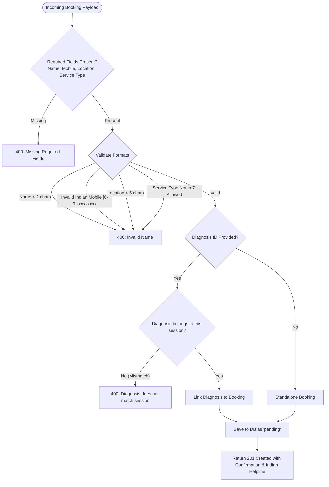

# System Decision Flows

This document details the step-by-step decision trees and runtime flows that govern Instant Mechanic. It shows **how requests travel through the system**, **what checks are made**, and **how the fallback cascades operate**.

---

## 1. High-Level System Architecture Flow

---

## 2. Chat & Symptom Triage Flow (`POST /api/chat/`)

Every incoming message is passed through a deterministic-first filter before any external AI is considered:

---

## 3. Media Upload & Warning Light Detection Flow (`POST /api/upload/`)

Media uploads follow a strict validation cascade and optional local YOLO inference:

---

## 4. Diagnosis & Uncertainty Routing Flow (`POST /api/diagnosis/`)

The diagnosis pipeline prioritizes passenger safety and uses conformal prediction sets to decide when to trust local ML versus escalating to an LLM:

---

## 5. Booking Flow (`POST /api/booking/`)

Booking operations are strictly deterministic and never depend on AI:

